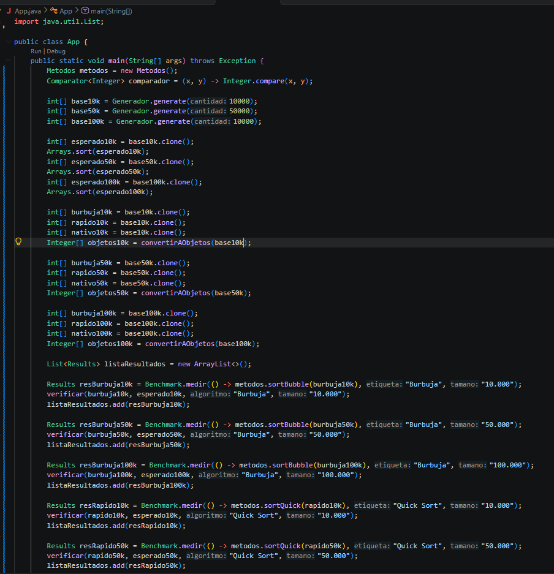

# INVESTIGACIÓN - Quick Sort

## Datos

- **Universidad Politécnica Salesiana**
- **Carrera:** Computación
- **Materia:** Estructura de Datos
- **Docente:** Ing. Pablo Torres, Mgtr.
- **Autor:** Juan David Coronel Palacios

## 1. Implementación utilizada

Quick Sort está en `Metodos.java`, en `sortQuick`, `ordenarRapido` y `dividir`. Es recursivo, ordena dentro del mismo arreglo y usa partición de Lomuto con el último elemento como pivote.

## 2. Funcionamiento

1. Si el tramo tiene 0 o 1 elemento, ya está ordenado (caso base).
2. `dividir` toma como pivote el último elemento del tramo.
3. Recorre el tramo y pasa a la izquierda los valores menores o iguales al pivote.
4. Coloca el pivote en su posición final y llama a `ordenarRapido` con el tramo izquierdo y el derecho.

## 3. Pivote y repetidos

El pivote siempre es `datos[hasta]`, y las llamadas recursivas lo excluyen, por eso la recursión termina. Los valores iguales al pivote quedan a su izquierda, así que funciona con repetidos, pero si hay muchos las particiones salen desbalanceadas.

## 4. Traza de referencia

Entrada: `[7, 2, 7, 0, 4, 2]`

| Tramo | Pivote | Resultado |
|---|---:|---|
| 0–5 | 2 | `[2, 0, 2, 7, 4, 7]` (el pivote queda en el índice 2) |
| 0–1 | 0 | `[0, 2, 2, 7, 4, 7]` |
| 3–5 | 7 | sin cambios (el pivote queda en el índice 5) |
| 3–4 | 4 | `[0, 2, 2, 4, 7, 7]` |

Resultado final: `[0, 2, 2, 4, 7, 7]`.

## 5. Complejidad, memoria y estabilidad

| Caso | Complejidad temporal | Motivo |
|---|---|---|
| Mejor caso | `O(n log n)` | El pivote divide el tramo en dos mitades parecidas. |
| Promedio | `O(n log n)` | Con datos aleatorios, las particiones quedan más o menos balanceadas. |
| Peor caso | `O(n²)` | El pivote es siempre el menor o el mayor, como en un arreglo ya ordenado. |

No usa arreglos auxiliares, pero la pila de recursión llega a `O(log n)` en promedio y a `O(n)` en el peor caso. No es estable, porque los intercambios pueden cambiar el orden de valores iguales.

## 6. Caso desfavorable y observaciones

El peor caso es un arreglo ya ordenado: el pivote es siempre el máximo del tramo, así que cada llamada descarta solo un elemento.

| Algoritmo | 10.000 (ms) | 50.000 (ms) | 1
|---|---:|---:|---:|
| Burbuja | 185.8069 | 6543.7858 |  |
| Quick Sort | 2.7551 | 9.1382 |  |
| Arrays.sort con int[] | 2.6242 | 10.3952 |  |
| Arrays.sort con Comparator en Integer[] | 23.1301 | 23.5399 |  

