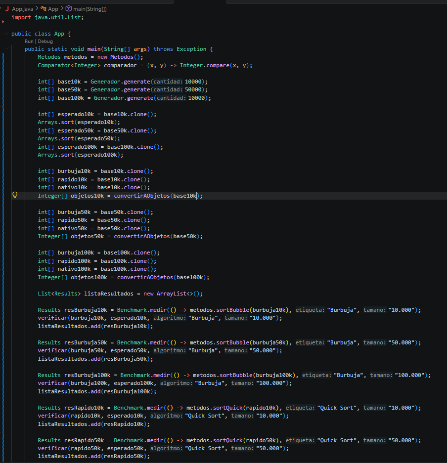

# PL1.1 - Comparativa de métodos de ordenamiento

## Datos

**Universidad Politécnica Salesiana**
- **Carrera:** Computación
- **Materia:** Estructura de Datos
- **Docente:** Ing. Pablo Torres, Mgtr.
- **Autor:** Juan David Coronel Palacios

## Objetivo

_Con tus palabras: qué comparas y con qué tamaños._

## Métodos utilizados

_Describe las cuatro variantes y en qué archivos están._

## Cómo ejecutar

_Explica cómo corres `App` y `Pruebas` en tu equipo._

## Cómo se hicieron las mediciones

_Explica qué queda dentro y qué fuera del cronómetro, y cómo se validan los resultados._

## Resultados

| Método | Sample | Tiempo (ms) |
|---|---:|---:|
| Burbuja | 10 000 | 185.8069 |
| Quick Sort | 10 000 | 2.7551 |
| Arrays.sort con int[] | 10 000 | 2.6242 |
| Arrays.sort con Comparator en Integer[] | 10 000 | 23.1301 |
| Burbuja | 50 000 | 6543.7858 |
| Quick Sort | 50 000 | 9.1382 |
| Arrays.sort con int[] | 50 000 | 10.3952 |
| Arrays.sort con Comparator en Integer[] | 50 000 | 23.5399 |
| Burbuja | 100 000 |  |
| Quick Sort | 100 000 |  |
| Arrays.sort con int[] | 100 000 |  |
| Arrays.sort con Comparator en Integer[] | 100 000 |  |

## Pruebas

## Análisis personal

_Lo que notaste tú al ejecutar._

## Conclusiones

_Tus conclusiones, apoyadas en tus números._

## Repositorio

- [Código y archivos de la práctica](tu-enlace-de-github)