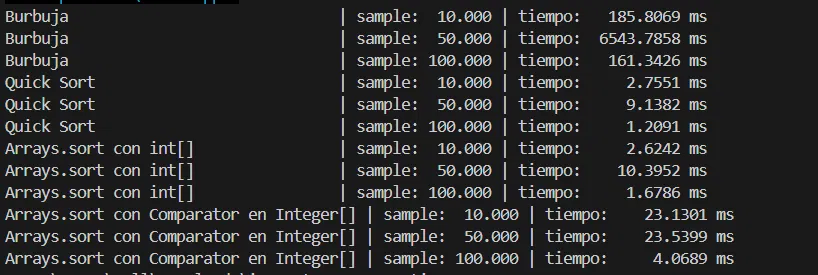

# PL1.1 - Comparativa de métodos de ordenamiento

## Datos

- **Universidad Politécnica Salesiana**
- **Carrera:** Computación
- **Materia:** Estructura de Datos
- **Docente:** Ing. Pablo Torres, Mgtr.
- **Autor:** Juan David Coronel Palacios

## Objetivo

Medir y comparar el tiempo que tardan cuatro formas de ordenar un arreglo de enteros, usando tres tamaños de muestra: 10 000, 50 000 y 100 000 elementos.

## Métodos utilizados

| Variante | Método | Tipo de arreglo |
|---|---|---|
| V1 | Burbuja | `int[]` |
| V2 | Quick Sort | `int[]` |
| V3 | `Arrays.sort` | `int[]` |
| V4 | `Arrays.sort` con `Comparator<Integer>` | `Integer[]` |

Burbuja y Quick Sort están programados en `Metodos.java`. Quick Sort usa partición de Lomuto con el último elemento como pivote. V3 y V4 usan la biblioteca estándar de Java.

## Archivos del proyecto

- `Generador.java`: crea arreglos de enteros aleatorios entre 0 y `n`, y rechaza tamaños negativos.
- `Metodos.java`: contiene los cuatro métodos de ordenamiento.
- `Benchmark.java`: mide con `System.nanoTime()` el tiempo de una tarea y devuelve un `Results`.
- `Results.java`: guarda el nombre del método, el tamaño de la muestra y la duración.
- `App.java`: ejecuta las 12 mediciones, valida los resultados e imprime la lista final.
- `Pruebas.java`: ejecuta las pruebas de aceptación y el caso desfavorable de Quick Sort.

## Cómo se hicieron las mediciones

Para cada tamaño se genera un solo arreglo aleatorio. Cada método recibe una copia independiente, para que ninguno trabaje sobre datos que otro ya ordenó. La generación, las copias, la conversión a `Integer[]` y la referencia ordenada se preparan antes del cronómetro.

`Benchmark` mide únicamente la llamada al método de ordenamiento. Al terminar cada medición, `App` compara el arreglo con la referencia ordenada con `Arrays.sort`. Si no coincide, lanza una excepción y el resultado no se agrega a la lista. Al final se imprimen las 12 mediciones.

## Resultados

| Método | Sample | Tiempo (ms) |
|---|---:|---:|
| Burbuja | 10 000 | 185.8069 |
| Quick Sort | 10 000 | 2.7551 |
| Arrays.sort con int[] | 10 000 | 2.6242 |
| Arrays.sort con Comparator en Integer[] | 10 000 | 23.1301 |
| Burbuja | 50 000 | 6543.7858 |
| Quick Sort | 50 000 | 9.1382 |
| Arrays.sort con int[] | 50 000 | 10.3952 |
| Arrays.sort con Comparator en Integer[] | 50 000 | 23.5399 |
| Burbuja | 100 000 |  |
| Quick Sort | 100 000 |  |
| Arrays.sort con int[] | 100 000 |  |
| Arrays.sort con Comparator en Integer[] | 100 000 |  |

Los valores corresponden a una sola ejecución por método y tamaño, así que no sirven para afirmar que un método será siempre más rápido.

## Pruebas

`Pruebas` comprueba estos casos con las cuatro variantes:

- Tamaño `n = 0` y tamaño negativo en el generador.
- Arreglo con valores repetidos (`[7, 2, 7, 0, 4, 2]`).
- Arreglo vacío, de un solo elemento y con todos los valores iguales.
- Arreglo ya ordenado y en orden inverso.
- Una operación que lanza excepción dentro de `Benchmark`.
- Caso desfavorable de Quick Sort: `n = 5 000` aleatorio contra ya ordenado.

## Análisis personal

Al ejecutar `App`, lo que más se notó fue la diferencia de Burbuja con los demás: con 50 000 elementos tardó más de 6 segundos (6543.7858 ms), mientras Quick Sort y `Arrays.sort` terminaron en alrededor de 10 ms. También se notó que la variante con `Comparator` fue la más lenta de las tres rápidas, y que los tiempos de 10 000 salieron relativamente altos, algo que atribuyo al calentamiento de la JVM (JIT) en la primera medición.

## Conclusiones

1. Burbuja escala mal: al pasar de 10 000 a 50 000 elementos (5 veces más datos) su tiempo creció unas 35 veces, coherente con su costo cuadrático `O(n²)`.
2. Quick Sort y `Arrays.sort` con `int[]` crecieron muy poco en comparación (alrededor de 3 y 4 veces), y con 50 000 elementos Quick Sort fue cerca de 700 veces más rápido que Burbuja.
3. Con `Integer[]` y `Comparator` el tiempo fue mayor que con `int[]` (23.5399 ms contra 10.3952 ms con 50 000), porque se trabaja con objetos y no con valores primitivos.
4. Quick Sort y `Arrays.sort` quedaron muy parejos. Como es una sola ejecución por tamaño, no basta para afirmar que uno sea siempre más rápido.
